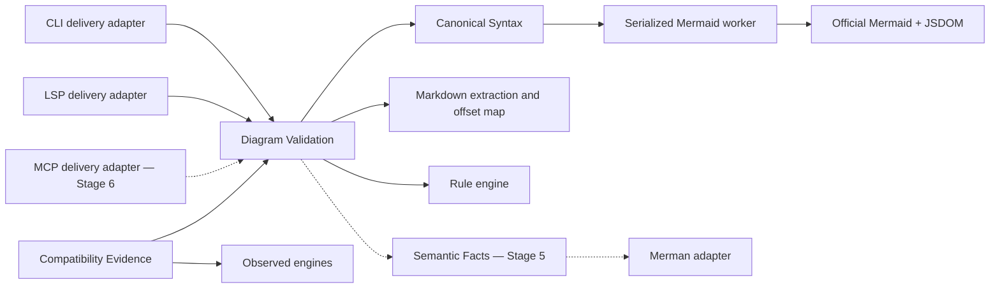
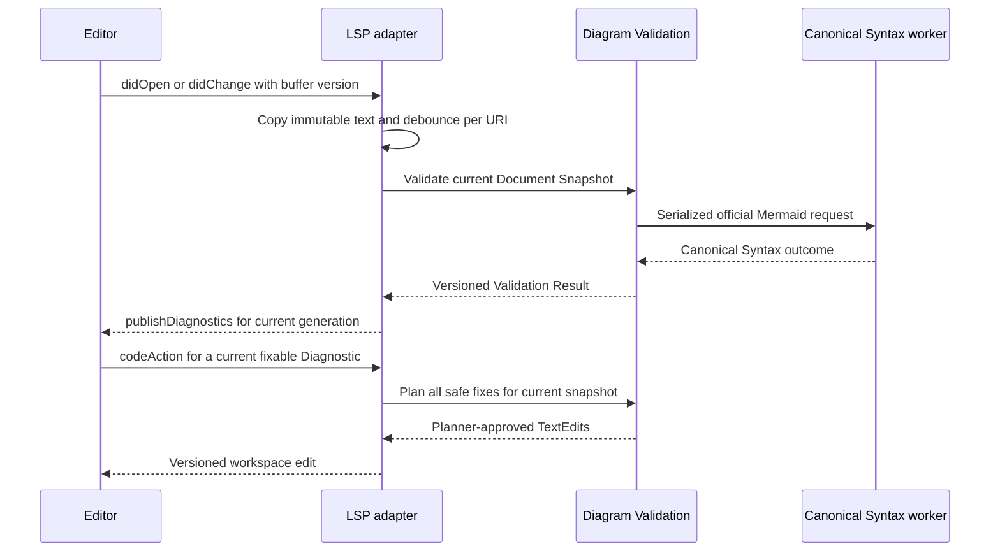
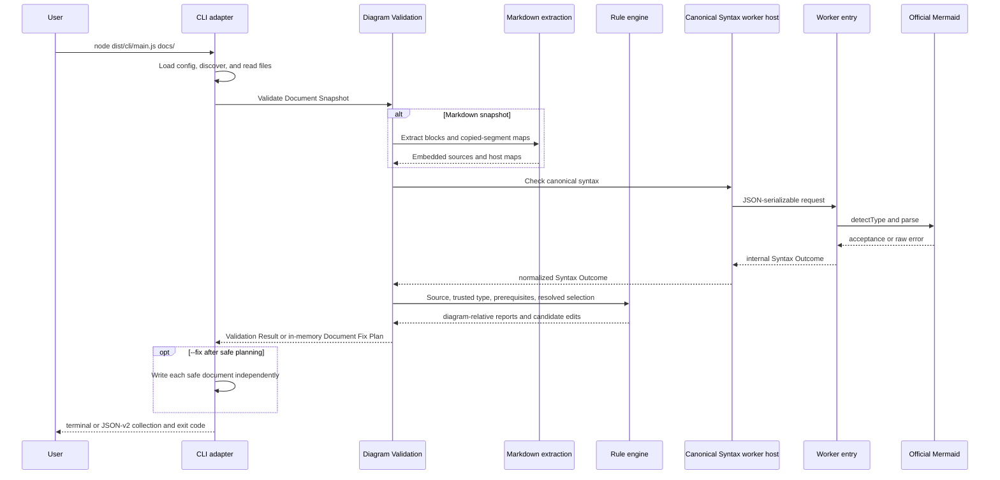

# Mermaid Diagram Validator Architecture

- Status: Accepted repository and module architecture
- Date: 2026-07-14
- Updated: 2026-07-30
- Stage 4 state: Complete
- Scope: Active non-visual roadmap in `DRAFT-PLAN.md`
- Package shape: One private TypeScript package through Stage 5; Stage 6 decides public exports and any justified split

## Purpose and authority

This document defines the repository structure, module responsibilities, dependency direction, and import rules for the Mermaid Diagram Validator. Implementation plans must use it when deciding where code belongs and which modules may depend on each other.

`DRAFT-PLAN.md` controls product scope, delivery stages, and stage exit criteria. This document controls module structure and dependency direction. Accepted ADRs control the decisions they record, including the canonical Mermaid profile in `docs/adr/0001-validation-foundation.md`. An ExecPlan must reference this document and repeat the rules relevant to its stage so that the ExecPlan remains self-contained as required by `PLANS.md`.

This document does not activate a later delivery stage. Only directories required by the active stage may be created.

## Architectural style

The repository uses a lightweight domain-driven design. The value of DDD here is precise domain language and clear module ownership, not a prescribed set of classes or generic top-level directories.

The current product has one bounded context: **Diagram Validation**. Within it, validation is a deep module: callers learn one small interface while the implementation hides Mermaid initialization, parser isolation, source mapping, rule prerequisites, semantic-fact completeness, and error normalization as those capabilities are introduced.

Do not create generic top-level `domain/`, `application/`, `infrastructure/`, `ports/`, `entities/`, `repositories/`, or `use-cases/` directories. Those names would split one validation operation across shallow technical modules and reduce locality. Organize by domain capability, then keep upstream implementations close to the capability that owns them.

## Domain language

Use these terms consistently in code, tests, plans, and documentation.

- **Document Snapshot** — an immutable in-memory view of one host document, identified by URI and language, with optional editor version metadata.
- **Diagram Validation** — the operation that accepts a Document Snapshot and produces a Validation Result.
- **Finding** — one stable user-facing diagnostic. It has a code, severity, message, source, location precision, and optional host-document span, help, fixes, and related locations.
- **Validation Result** — the complete deterministic result of validating one Document Snapshot, including findings and any stage-specific metadata that belongs to the active Diagram Validation module contract.
- **Canonical Syntax** — the official Mermaid verdict for a diagram under the exact-pinned profile accepted in ADR 0001.
- **Syntax Outcome** — the internal result returned by the Canonical Syntax module before Diagram Validation maps it into Findings. It never crosses the Canonical Syntax module seam.
- **Delivery Adapter** — a module that translates an external interaction into a Document Snapshot or translates a Validation Result into an external representation. CLI, LSP, and MCP are delivery adapters.
- **Compatibility Evidence** — the Stage 0 corpus, observations, comparison engines, and process-isolation harness used to verify assumptions. Compatibility Evidence does not define product contracts.
- **Semantic Facts** — versioned, completeness-qualified diagram facts used by later rules. They cannot override Canonical Syntax.

## Architectural invariants

The following rules apply to every active stage.

1. Official Mermaid is the only canonical syntax authority.
2. Diagram Validation has one asynchronous in-memory interface shared by every delivery adapter.
3. Delivery adapters depend inward on Diagram Validation. Diagram Validation never depends on a delivery adapter.
4. Compatibility Evidence may observe the product, but product modules never import Compatibility Evidence contracts or implementations.
5. Upstream and experimental dependencies are exact-pinned and imported only by project-owned local adapters.
6. Raw Mermaid, Merman, and mermaid-lint values never cross the Diagram Validation module interface.
7. Through Stages 1–5, `index.ts` files define repository module seams only. The package remains private, emits no supported package-level programmatic interface, and may revise those module contracts as implementation evidence accumulates.
8. Stage 6 decides which interfaces, if any, receive declaration output, `package.json` exports, migration policy, and public compatibility support.
9. The repository remains one package until real public-interface or release-cycle differences justify a split.
10. Only modules required by the active stage may exist. Future empty directories are prohibited.
11. Rendering, image, geometry, layout-comparison, and vision modules and dependencies remain prohibited until the deferred visual roadmap is explicitly reactivated.
12. TypeScript source belongs under `src/`; compiled JavaScript, source maps, and build metadata belong under `dist/`, never beside TypeScript source files.

## Module dependency direction

An arrow means that the module at the tail may import or call the module at the head.



Solid arrows are active through Stage 4 or already exist as Compatibility Evidence. Dotted arrows show accepted later-stage direction and do not authorize creating those modules early.

There are no sideways calls between delivery adapters. CLI does not call LSP or MCP; LSP does not shell out to CLI. All delivery adapters cross the same Diagram Validation interface.

## Stage 4 active structure

Stage 4 uses the following product structure. Compatibility Evidence remains under `src/compatibility/` as shown elsewhere in this document.

```text
src/
  validation/
    index.ts
    document.ts
    findings.ts
    validate-document.ts
    fix-document.ts
    rules/
      index.ts
      contracts.ts
      options-schema.ts
      configuration.ts
      registry.ts
      run-rules.ts
      fixes.ts
      builtins/
        no-markdown-heading-in-label.ts
    markdown/
      index.ts
      contracts.ts
      extract-markdown.ts
      offset-map.ts
    canonical-syntax/
      index.ts
      protocol.ts
      worker-host.ts
      worker-entry.ts
      mermaid-runtime.ts
      normalize-mermaid-error.ts

  cli/
    contracts.ts
    config.ts
    discovery.ts
    main.ts
    terminal-output.ts
    json-v2-output.ts

  lsp/
    main.ts
    server.ts
    contracts.ts
    diagnostics.ts
    validation-scheduler.ts

  compatibility/
    contracts.ts
    normalize.ts
    run-isolated.ts
    worker.ts
    engines/
      official-mermaid.ts
      mermaid-lint.ts
      merman.ts

fixtures/
  compatibility/
    flowchart/
    sequence/
    pie/
    class/
    state/

tests/
  contract/
    validation/
  integration/
    cli/
  compatibility/
  architecture/
```

Markdown extraction, mapping, the Rule Engine, and in-memory fix planning are internal capabilities of Diagram Validation. Configuration, config-root path matching, filesystem discovery, file reads and writes, collection aggregation, and JSON-v2 remain CLI delivery responsibilities. Open-buffer ownership, protocol lifecycle, UTF-16 Diagnostic projection, version-aware scheduling, and planner-backed Code Actions belong to the LSP delivery adapter. Later-stage directories are still absent.

## Module responsibilities

### Diagram Validation: `src/validation/`

This is the product's deep domain module and the only product interface shared by delivery adapters.

It owns:

- `DocumentSnapshot`, `Finding`, `ValidationResult`, and the asynchronous `validateDocument` operation;
- stable diagnostic codes and location-precision semantics;
- orchestration of active validation capabilities;
- translation from internal Syntax Outcomes into module-interface Findings;
- later source-map, rule-prerequisite, fix, and semantic-fact policies when their stages activate.

It does not own:

- filesystem reads, path discovery, terminal colors, process exit codes, or command-line parsing;
- LSP, MCP, SARIF, JUnit, or other delivery-specific representations;
- raw Mermaid error objects, JSDOM setup, worker restart mechanics, or comparison-engine observations.

`src/validation/index.ts` is the sole repository module import seam for code outside `src/validation/`. It exports only the product types and operations needed by active delivery adapters and contract tests, and it must not re-export Canonical Syntax internals or upstream types. Through Stage 5 this is not an npm package export and carries no external compatibility promise.

### Canonical Syntax: `src/validation/canonical-syntax/`

This is an internal deep module owned by Diagram Validation. It hides all behavior required to obtain a reliable official Mermaid verdict.

It owns:

- worker serialization and the host/worker message protocol;
- bounded timeouts, crash detection, restart behavior, and disposal;
- JSDOM global installation before Mermaid is dynamically imported;
- the exact Mermaid initialization profile accepted by ADR 0001;
- opportunistic diagram-type detection and mandatory official parsing;
- normalization of upstream errors into an internal Syntax Outcome.

`worker-host.ts` is the parent-process implementation. `worker-entry.ts` is the executable child-process entry. `protocol.ts` contains only JSON-serializable host/worker messages. `mermaid-runtime.ts` is the only product file allowed to import `mermaid` or `jsdom`. `normalize-mermaid-error.ts` is the only product implementation that understands raw Mermaid error shapes.

The Canonical Syntax interface is internal. CLI, LSP, MCP, and Compatibility Evidence must not deep-import it. They validate through `src/validation/index.ts`.

Do not define a generic parser seam that treats official Mermaid, Merman, and mermaid-lint as interchangeable adapters. They are not interchangeable: official Mermaid is the fixed syntax authority; the others are observed compatibility engines or later Semantic Facts sources.

### CLI delivery adapter: `src/cli/`

The CLI translates command-line interactions into Diagram Validation calls.

It owns:

- command-line parsing and version output;
- supported standalone-file checks and filesystem reads;
- creation of Document Snapshots;
- terminal and versioned JSON projections;
- deterministic process exit codes;
- nearest-upward JSON configuration loading, repository discovery, nested ignore handling, and bounded file reads;
- deterministic multi-document collection aggregation and JSON-v2 projection.

It may import only the Diagram Validation module interface. It must not import Mermaid, JSDOM, worker internals, Compatibility Evidence, or future LSP/MCP modules.

Terminal and JSON output remain inside the CLI module while the CLI is their only real caller. Do not create a top-level `reporters/` module for hypothetical later formats. Promote output into a separate deep module only when a second real caller or independent release contract justifies that seam.

### LSP delivery adapter: `src/lsp/`

The LSP adapter translates open editor buffers and Language Server Protocol messages into Diagram Validation calls and protocol responses.

It owns:

- the stdio-only process entry, initialize/shutdown/exit lifecycle, and incremental text-document store;
- immutable notification-time snapshots, per-URI debounce/cancellation/generation state, and versioned push diagnostics;
- UTF-16 projection of host-document offsets into LSP ranges;
- capability-gated, current-version Code Actions built only from `planDocumentFixes()`.

It imports product behavior only through `src/validation/index.ts`. It does not import CLI configuration/discovery, read open documents from disk, write files, shell out, expose package-level APIs, or interpret Mermaid, Markdown, rule, or worker internals. Upstream LSP protocol values remain inside `src/lsp/`.

### Compatibility Evidence: `src/compatibility/`

This supporting module preserves the Stage 0 corpus and proves dependency and engine assumptions. It is not part of the Diagram Validation product module.

It owns:

- fixture and Engine Observation contracts;
- normalization used only by the compatibility matrix;
- isolated comparison workers and failure fixtures;
- direct observations of official Mermaid, mermaid-lint, and Merman;
- the normalized 27-fixture, 108-observation evidence snapshot.

It may import the Diagram Validation module interface to prove product behavior and may directly import exact-pinned observed engines inside `src/compatibility/engines/`. No production module may import from it.

The compatibility direct-official observer is an independent oracle for evidence. It does not become the product implementation merely because both use the same exact-pinned Mermaid package and accepted profile.

## Stage-by-stage module growth

Later stages extend Diagram Validation or add delivery adapters without reversing dependency direction.

### Stage 2: repository and Markdown input

Stage 2 adds `src/validation/markdown/` for CommonMark fence extraction and segment-level embedded-to-host offset maps. Its project-owned contracts never expose mdast nodes. Root Diagram Validation validates every extracted diagram through Canonical Syntax and returns only host-document Findings. File discovery, ignore processing, configuration-file discovery, collection aggregation, and filesystem reads remain in the CLI delivery adapter.

### Stage 3: rules and fixes

Add the rule engine and rule implementations inside `src/validation/`. Rules consume project-owned text or fact contracts, never upstream AST values. Configuration discovery remains outside Diagram Validation; validated rule configuration is passed into the in-memory operation. Fix conflict, bounds, and idempotence policies belong to Diagram Validation. Prove extensibility with repository-local external-style fixture plugins, but keep the registration seam private and revisable through Stage 5.

### Stage 4: LSP delivery adapter

Add `src/lsp/` as a delivery adapter importing only `src/validation/index.ts`. Open editor buffers are the source of truth. LSP converts host UTF-16 offsets into protocol ranges and converts safe fixes into code actions. It never shells out to CLI and never rereads an open document from disk.

### Stage 5: Semantic Facts

Add a Semantic Facts capability inside `src/validation/`. The project-owned fact contracts include version and completeness metadata. A local Merman adapter may implement those contracts and is the only product location allowed to import Merman. Incomplete facts cause dependent rules to be skipped; they never change Canonical Syntax.

### Stage 6: hardening and integrations

Add `src/mcp/` as another delivery adapter over Diagram Validation. SARIF and JUnit projections may remain with the CLI if it remains their sole caller. A separate output module requires evidence of multiple callers or an independently stable interface; do not create one merely to mirror an aspirational diagram. Decide which programmatic interfaces have enough evidence to become supported package exports, then emit declarations, add explicit `package.json` exports, and attach migration policy and installed-consumer tests only to those interfaces.

## Runtime data flow

Stage 4 preserves the Stage 3 CLI flow and adds this editor delivery flow.



The CLI flow remains:



Error knowledge narrows as it travels outward:

```text
Raw Mermaid error
  -> internal Syntax Outcome
  -> stable Finding
  -> terminal, JSON, LSP, SARIF, JUnit, or MCP projection
```

Raw upstream payloads may be retained in internal debug evidence, but they must not become stable public fields.

## Import rules

These rules are written so a later architecture fitness check can enforce them mechanically.

### Allowed internal edges

| Importer | Allowed project imports |
|---|---|
| `src/cli/**` | `src/cli/**`, `src/validation/index.ts` |
| `src/validation/index.ts` | Module-interface types and operations in the root of `src/validation/` |
| `src/validation/*.ts` | Other root validation files, `src/validation/canonical-syntax/index.ts`, and capabilities activated for the current stage |
| `src/validation/canonical-syntax/**` | Files within the same subtree |
| `src/validation/markdown/**` | Files within the same subtree |
| `src/validation/rules/**` | Files within the same subtree |
| `src/compatibility/**` | `src/compatibility/**`, `src/validation/index.ts` |
| `src/lsp/**` | `src/lsp/**`, `src/validation/index.ts` |
| `src/mcp/**` | `src/mcp/**`, `src/validation/index.ts` |

An import of `src/validation/document.ts`, `findings.ts`, `validate-document.ts`, or any deeper path from outside `src/validation/` is forbidden. Repository modules outside `src/validation/` import through `src/validation/index.ts` only. This rule defines an internal module seam, not a package export.

### Forbidden edges

- `src/validation/**` must not import `src/cli/**`, `src/lsp/**`, `src/mcp/**`, or `src/compatibility/**`.
- Delivery adapters must not import each other.
- Product modules must not import `src/compatibility/**`, `fixtures/**`, or `tests/**`.
- `src/validation/*.ts` must not bypass `canonical-syntax/index.ts` to import Canonical Syntax implementation files.
- `src/validation/*.ts` must not bypass `markdown/index.ts` to import Markdown implementation files.
- `src/validation/*.ts` must not bypass `rules/index.ts` to import Rule Engine implementation files.
- `src/validation/markdown/**` must not import CLI, Canonical Syntax, Compatibility Evidence, or root Validation types.
- `src/validation/rules/**` must not import CLI, Compatibility Evidence, Markdown internals, Canonical Syntax internals, filesystem/process APIs, or comparison-engine packages.
- No module may form a circular project import.
- No future-stage module may be introduced before its stage is active.
- No visual module or dependency may enter the active graph without an explicit roadmap reactivation decision.

### External dependency ownership

| Dependency | Allowed import locations |
|---|---|
| `mermaid` | `src/validation/canonical-syntax/mermaid-runtime.ts`; compatibility engine observers |
| `jsdom` | `src/validation/canonical-syntax/mermaid-runtime.ts`; compatibility engine observers |
| `mdast-util-from-markdown` | `src/validation/markdown/extract-markdown.ts` only |
| `globby` | `src/cli/discovery.ts` only |
| `zod` | `src/validation/rules/options-schema.ts` only |
| `@mermaid-lint/core` | `src/compatibility/engines/**` until a later accepted use is planned |
| `@mermanjs/web` | `src/compatibility/engines/**`; later the Stage 5 Merman Semantic Facts adapter |
| CLI framework | `src/cli/**` only |
| `vscode-languageserver` `10.1.0`; `vscode-languageserver-textdocument` `1.0.12` | `src/lsp/**` only |
| MCP packages | `src/mcp/**` only |
| `node:child_process` | Canonical Syntax worker host and compatibility process runner only |
| `node:fs` and filesystem path discovery | Delivery adapters and compatibility tooling; not root Diagram Validation files |

Every upstream import remains exact-pinned in `package.json` and hidden behind a project-owned implementation. Adding a dependency requires reading `DRAFT-PLAN.md`, confirming the active stage, and updating an ADR when the dependency changes an accepted architecture decision.

## Test relationships

Tests should cross the same interfaces as real callers whenever practical.

- `tests/contract/validation/` imports only `src/validation/index.ts` and verifies the active in-memory module contract.
- `tests/integration/cli/` invokes the built CLI and verifies files, output formats, exit codes, and process behavior.
- `tests/integration/lsp/` invokes the built stdio server through a repository-owned framed client and verifies protocol lifecycle, unsaved buffers, diagnostics, parity, and Code Actions.
- `tests/compatibility/` imports Compatibility Evidence and verifies engine observations and corpus invariants.
- `tests/architecture/` checks dependency, package, path, and deferred-scope invariants.
- Narrow internal tests may deep-import an implementation only from a clearly named `tests/internal/` location or be colocated with that internal module. Such exceptions must not be used as substitutes for module contract tests.

The Stage 0 `tests/architecture/no-visual-dependencies.test.ts` is the first architecture fitness check. Later checks should extend the same principle rather than replacing behavioral tests with file-layout assertions.

## Static enforcement contract

`tests/architecture/module-import-boundaries.test.ts` is the active focused import-graph checker. It uses the TypeScript AST and resolver already present in the test toolchain; it adds no product dependency or standalone command and runs inside `pnpm check`.

The checker:

1. Parse TypeScript ESM imports using the repository's NodeNext conventions.
2. Classify files into the module zones defined in this document.
3. Fail on every forbidden edge and on deep imports that bypass a module `index.ts` seam.
4. Fail on circular project imports.
5. Enforce the external dependency ownership allowlist.
6. Ignore generated `dist/` output and dependency directories.
7. Provide actionable diagnostics naming the importer, imported file or package, and violated rule.
8. Runs as part of `pnpm check`, with focused synthetic edges proving that allowed imports pass and forbidden imports fail.

Representative violating cases include:

- Diagram Validation importing CLI;
- CLI deep-importing `validation/canonical-syntax/worker-host.ts`;
- CLI importing `mermaid` directly;
- one delivery adapter importing another;
- product code importing Compatibility Evidence;
- Compatibility Evidence importing CLI or a Validation deep path;
- root Validation bypassing the Rules seam;
- Rules importing delivery, compatibility, Canonical Syntax/Markdown internals, filesystem/process APIs, or comparison engines;
- Zod imported outside the rule option adapter;
- LSP importing CLI, Validation internals, filesystem/path/child-process APIs, or LSP packages imported outside `src/lsp/`;
- a project import cycle.

The checker must not silently exempt all tests. Any test-only exception must be path-scoped and documented.

## ExecPlan requirements

Every later ExecPlan that changes source structure or dependencies must:

1. Reference `ARCHITECTURE.md`, `DRAFT-PLAN.md`, `PLANS.md`, and relevant ADRs.
2. Restate the module responsibilities and import rules needed for that plan so the plan remains self-contained.
3. Name every directory it creates and explain why the active stage requires it.
4. Identify module interfaces, internal interfaces, and any externally supported interfaces, and specify which types cross each seam.
5. Include tests proving dependency direction as well as user-visible behavior.
6. Preserve Stage 0 Compatibility Evidence or describe a test-preserving migration.
7. Avoid importing Compatibility Evidence types into product modules.
8. Keep later-stage modules absent.
9. Update this document and record an ADR if implementation evidence requires changing a load-bearing dependency direction or module responsibility.

Trivial filename refinements do not require an ADR when module ownership and dependency direction remain unchanged. Reversing an allowed edge, exposing an internal upstream type, adding a new canonical engine, or splitting the package does require an ADR.

## Explicitly rejected structures

The following structures are intentionally rejected for the current product:

- top-level `domain/`, `application/`, and `infrastructure/` directories;
- one top-level adapter directory containing unrelated Mermaid, CLI, LSP, Merman, and MCP implementations;
- a generic parser interface that makes official Mermaid interchangeable with noncanonical engines;
- package-level programmatic exports before Stage 6 accepts their compatibility and migration obligations;
- a top-level reporter directory created before multiple real callers exist;
- product imports from the Stage 0 spike or compatibility observation contracts;
- a monorepo split based only on the future roadmap;
- future-stage placeholder directories.

These decisions favor locality: each domain capability owns its interface and implementation, while delivery and upstream details stay behind narrow seams.

## Stage 4 verification evidence

Stage 4 is complete behind private version `0.3.0`. The architecture is unchanged: the durability fix is the test-orchestration policy `fileParallelism: false`, selected after the two-worker candidate produced a process-heavy CLI test timeout during repeated Node 24 proof. On the unchanged final surface, three consecutive default Node 24.18.0 full gates passed 29 files/264 tests with one opt-in skip in 273.31, 185.51, and 187.30 seconds; the Node 22.20.0 full gate passed the same counts in 229.84 seconds. Compatibility Evidence passed 4 files/16 tests over 27 fixtures/108 observations on both runtimes. The canonical 10-second startup/request deadline, Vitest's 20-second test timeout, real-process coverage, and no-retry policy remain unchanged. This closes the recorded local Stage 4 gate without claiming hosted-CI or cross-platform certification. The direct LSP pins remain `vscode-languageserver@10.1.0` and `vscode-languageserver-textdocument@1.0.12`, with `vscode-languageserver-protocol@3.18.2` owned transitively by the server package.
