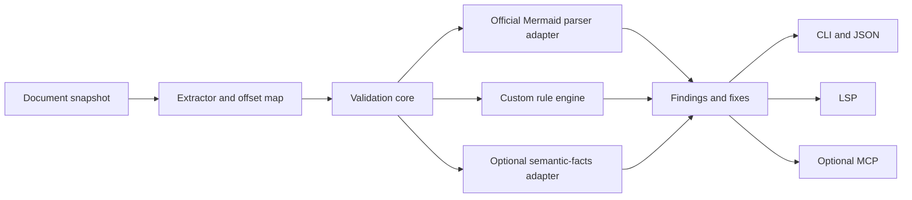

# Mermaid Validator — Implementation Plan

- Status: Stages 0–4 complete; Stage 4 CLI preview published and trusted tag-driven releases configured; Stage 5 not started
- Updated: 2026-08-07
- Runtime: TypeScript on Node.js
- Package manager: pnpm
- Repository shape: one CLI-only public preview package after Stage 4; Stage 6 decides which programmatic interfaces become public
- Active scope: syntax, source mapping, custom rules, semantic rules, CLI/JSON, LSP, and CI integrations
- Deferred scope: rendering, geometry analysis, layout comparison, screenshots, and model-based visual review

## 1. Outcome

Build a validator that can:

1. Report Mermaid syntax errors with the best available source location.
2. Run configurable custom rules and offer safe fixes.
3. Support Flowchart, Sequence, Pie, Class, and State diagrams.
4. Validate standalone Mermaid files and embedded Markdown blocks.
5. Expose one validation core through CLI/JSON, LSP, and optional MCP adapters.

The implementation is progressive. Syntax truth, source mapping, and the custom-rule contract must be reliable before broad semantic coverage or integrations are added.

## 2. Scope

### Active scope

- Standalone `.mmd` and `.mermaid` files.
- Exact-lowercase `mermaid` fenced blocks in Markdown.
- Flowchart, Sequence, Pie, Class, and State diagrams.
- Compiler-style terminal diagnostics and versioned JSON output.
- An evolving custom-rule contract with asynchronous rules and safe fixes, proven internally before any package-level programmatic publication.
- Semantic rules based on versioned facts with completeness metadata.
- IDE diagnostics and quick fixes through a standalone language server.
- SARIF/JUnit output and CI integration after the core stabilizes.
- Optional MCP adapter for tool-native agents.

### Explicitly deferred

- SVG or PNG artifact generation.
- Browser rendering as a product feature.
- Geometry extraction and overlap, density, spacing, or aspect-ratio rules.
- Layout comparison or layout suggestions.
- Vision-capable model review.
- Image-provider SDKs, prompt schemas, screenshot caches, or visual evaluation corpora.

Visual work is recorded in a separate deferred roadmap in Section 8. It adds no dependencies and creates no acceptance criteria for the active releases.

### Other non-goals

- Reimplementing the complete Mermaid grammar.
- Supporting every Mermaid diagram type in the initial product.
- Promising an exact token range for every Mermaid parser error.
- A hosted service, custom renderer, or VS Code-only implementation.
- Splitting into a monorepo before real package boundaries emerge.

## 3. Accepted decisions

| ID | Decision | Rationale |
|---|---|---|
| D001 | Official Mermaid is the canonical syntax authority. | The validator should agree with the renderer ecosystem it claims to validate. Independent parsers may accelerate or enrich analysis but cannot turn an official failure into a pass. |
| D002 | Evaluate and reuse `@mermaid-lint/core` before building a new foundation. | It already covers substantial extraction, diagnostics, configuration, fix, CLI, and editor work. A local adapter protects the project from pre-1.0 changes and closed internal contracts. |
| D003 | Treat Merman (`@mermanjs/web`) as an optional semantic-facts accelerator. | Its facts and editor capabilities may reduce custom parser work, but it is an independent implementation and must remain replaceable. |
| D004 | Keep one asynchronous in-memory validation core. | CLI, LSP, tests, and optional MCP must produce equivalent results without shelling out to each other. |
| D005 | Use absolute UTF-16 offsets in the original host document as canonical positions. | Terminal line/column and LSP ranges can be derived consistently, including Unicode and embedded Markdown. |
| D006 | Make rule prerequisites explicit. | Rules must not run when required syntax or semantic facts are incomplete; Stage 5 adds facts completeness and observable skip metadata together. |
| D007 | Start as one package. | Package boundaries should follow stable public APIs and differing release cycles, not the aspirational architecture diagram. |
| D008 | Use Node.js 24 LTS, TypeScript ESM, and pnpm. | This is a greenfield TypeScript/Node tool and current dependencies require a modern runtime floor. |
| D009 | Add LSP after source mapping and the first fixable rule. | Editor integration should validate unsaved buffers through the shared core; it should not be bolted onto a mature CLI later. |
| D010 | Defer every visual feature. | The agreed product focus is compiler-like validation and programmable lint rules. Rendering, geometry, and vision do not block that outcome. |
| D011 | Do not adopt `@mermaid-js/parser` as the sole AST layer. | Its public coverage is not sufficient for all five target diagram families. |
| D012 | Keep Mermaid CLI outside the active stack. | It is unnecessary for the non-visual product. If visual work is reactivated, it may be used only as a development compatibility oracle because its Node API is not a product runtime contract. |
| D013 | Keep programmatic interfaces private through Stages 1–5. | Early stages need fast iteration across validation, rules, facts, and delivery adapters without JavaScript/TypeScript API compatibility commitments. Stage-local `index.ts` files are repository module seams, not package exports; Stage 6 decides which interfaces receive declarations, package exports, migration policy, and public support. |
| D014 | Allow a CLI-only npm preview after Stage 4. | Executable distribution enables real-world feedback without stabilizing internal imports. The package exposes only the `mermaid-validator` bin, denies every programmatic import with an empty `exports` map, stays on `0.x`, and uses trusted publishing as recorded in ADR 0002. LSP publication is deferred. |

Stage 0 validates the ecosystem assumptions behind D001–D003 and records any necessary adjustment in an ADR. The product and scope decisions remain unchanged.

## 4. Active architecture



### 4.1 Canonical syntax truth

Canonical mode always obtains a verdict from the exact-pinned official Mermaid version.

`@mermaid-lint/core` sits behind a project-owned adapter. If its fast path accepts an independent parser result without consulting official Mermaid, that path may be exposed only as an explicitly non-canonical editor optimization. CI defaults to canonical mode.

Merman facts can enrich rule input but cannot override the official syntax verdict.

### 4.2 One in-memory API

```ts
export interface DocumentSnapshot {
  uri: string;
  languageId: "mermaid" | "markdown" | "mdx";
  text: string;
  version?: number;
}

export interface ValidateOptions {
  mode: "canonical" | "fast";
  config?: ValidatorConfig;
  signal?: AbortSignal;
}

export async function validateDocument(
  document: DocumentSnapshot,
  options: ValidateOptions,
): Promise<ValidationResult>;
```

The CLI reads files and creates snapshots. The LSP uses the current editor buffer and never shells out to the CLI or rereads an open document from disk.

### 4.3 Diagnostic contract

```ts
export type LocationPrecision = "exact" | "approximate" | "document";

export interface Finding {
  code: string;
  severity: "error" | "warning" | "info";
  message: string;
  source: "mermaid" | "rule" | "system";
  span?: { startOffset: number; endOffset: number };
  locationPrecision: LocationPrecision;
  diagramType?: string;
  engine?: { name: string; version: string };
  help?: string;
  fixes?: TextEdit[];
  related?: RelatedLocation[];
  raw?: unknown;
}
```

Raw Mermaid tokens and expected-token lists may be retained for debugging, but they are not a stable public API. The engine distinguishes:

- invalid Mermaid syntax;
- unsupported diagram type;
- parser initialization failure;
- timeout or worker crash.

### 4.4 Source mapping

Markdown extraction stores a segment-level map from the embedded Mermaid source back to the original host document. A block start-line offset is not sufficient because lists, blockquotes, and indentation can cause dedenting or normalization.

Canonical positions are absolute UTF-16 offsets in the host document. Terminal one-based line/column and LSP zero-based UTF-16 ranges are views derived from those offsets.

### 4.5 Rule contract

Rules are namespaced, asynchronous, schema-validated, and declare prerequisites. Stage 3 supports:

- `text`: raw source is sufficient.
- `syntax-valid`: official Mermaid accepted the diagram.

Stage 5 extends this contract with `facts`, meaning the required semantic facts are present and sufficiently complete, and introduces user-visible skip metadata when incomplete-facts behavior becomes actionable. If a prerequisite is missing or uncertain, the engine does not run the rule. Safe fixes must be bounded, non-overlapping, and idempotent.

### 4.6 Parser isolation

Mermaid is browser-oriented and uses mutable global state. Canonical parsing runs in a serialized worker with the DOM environment initialized before Mermaid is dynamically imported. The parent host enforces separate 10-second startup and request deadlines. A source-independent startup failure suppresses further starts in that process for a fixed, demand-driven 5-second interval; one request timeout permits one fresh worker, while a second consecutive request timeout opens the same suppression. Suppressed requests receive honest system Findings and are never treated as valid. The policy is process-local and does not coordinate initial worker launches across separate CLI or LSP processes.

A browser-backed parsing fallback is a contingency only if Stage 0 proves JSDOM cannot reliably support canonical parsing. Such a fallback would be parser infrastructure, not activation of the deferred visual roadmap, and would require a separate decision before adding a browser dependency.

## 5. Technology choices

### Active stack

| Concern | Choice | Introduced | Decision |
|---|---|---:|---|
| Runtime | Node.js 24 LTS | Stage 0 | Test Node 22 and 24 if exact dependency ranges permit. |
| Language | TypeScript, ESM, `NodeNext` | Stage 0 | Enable strict compiler settings. |
| Package manager | pnpm `10.30.1` | Stage 0 | Commit the lockfile and exact-pin parser-related dependencies. |
| Test runner | Vitest `4.1.10` | Stage 0 | Use fixture, contract, unit, and integration tests. |
| Canonical parser | `mermaid` `11.16.0` | Stage 0 | Use the strict JSDOM profile recorded in ADR 0001. |
| Reusable foundation | `@mermaid-lint/core` `0.35.0` | Stage 0 | Wrap selected exports behind local adapters; aggregate validation is noncanonical. |
| Parser DOM | `jsdom` `26.1.0` | Stage 1 runtime | JSDOM-only parsing passed the full Stage 0 corpus and now initializes the isolated canonical worker. |
| CLI | `commander` `15.0.0` | Stage 1 | Keep it a thin adapter over the in-memory core. |
| Terminal diagnostics | Project-owned compiler-style lines | Stage 1 | Source offsets are projected without a code-frame dependency. |
| Markdown structure | `mdast-util-from-markdown` `2.0.3` behind `src/validation/markdown/extract-markdown.ts` | Stage 2 | Exact-pin CommonMark fence structure and source positions without exposing mdast types or changing Mermaid syntax authority. |
| Config/rule schemas | Project-owned JSON shape check in Stage 2; `zod` for rule schemas | Stage 2/3 | Keep the one-field Stage 2 config dependency-free; introduce Zod when Stage 3 rule options justify it. |
| Config discovery | Project-owned nearest-upward `mermaid-validator.config.json` search | Stage 2 | Use Node filesystem/path APIs for the single optional repository config and exact `--config` override. |
| File discovery | `globby` `16.2.2` behind `src/cli/discovery.ts` | Stage 2 | Exact-pin one adapter-owned dependency for recursive discovery and nested `.gitignore` handling. |
| Semantic facts | `@mermanjs/web` `0.7.0` behind an adapter | Stage 5 | Reuse only with completeness metadata; selected facts matched all 12 valid Stage 0 fixtures after recursive State-document extraction. |
| LSP server | `vscode-languageserver` `10.1.0`, `vscode-languageserver-textdocument` `1.0.12` | Stage 4 | Exact-pinned behind the private `src/lsp/` stdio adapter; protocol `3.18.2` remains transitive. |

### Deliberately excluded from the active stack

- `playwright`, Puppeteer, or browser binaries.
- `@mermaid-js/mermaid-cli` during active Stages 0–6.
- `p-limit` for render/model concurrency.
- `sharp`, `pngjs`, or `pixelmatch`.
- OpenAI or other vision-provider SDKs.
- `cheerio` or `fast-xml-parser` for SVG inspection.
- `@mermaid-js/parser` as the target-type AST foundation.
- `remark-gfm` merely to extract Mermaid fences.
- `ajv` until a public JSON Schema contract is required.

Do not use `optionalDependencies` to smuggle deferred or experimental integrations into the default installation. If visual work is activated later, its dependencies should live behind separate entry points or packages.

## 6. Active delivery stages

The `v0.1` through `v0.4` release cuts below began as internal milestones. ADR 0002 activates a narrow exception after Stage 4: the existing CLI executable may be published as a `0.x` npm preview, while the LSP stays checkout-only and every programmatic package import remains blocked through Stage 5. Stage 6 still owns stable programmatic interfaces and the broader production-ready release contract.

### Stage 0 — Compatibility and reuse spike

Status: Completed again on 2026-07-14 after evidence hardening and local Node 22/24 verification.

Purpose: prove the foundation before choosing between wrapping, contributing upstream, or replacing pieces.

Work:

- Initialize the TypeScript/pnpm package and Vitest harness.
- Exact-pin the evaluated Mermaid, `@mermaid-lint/core`, and Merman versions.
- Create a compatibility corpus for Flowchart, Sequence, Pie, Class, and State:
  - at least two valid fixtures per type;
  - at least three invalid fixtures per type;
  - representative source-location failures;
  - current syntax variants used by target editors.
- Compare official Mermaid under JSDOM, `@mermaid-lint/core`, and optional Merman verdicts/facts.
- Snapshot error families, type normalization, available locations, and crashes.
- Determine whether the local adapter can wrap upstream unchanged, needs an upstream contribution, or requires a narrow fork.
- Record the result and supported Mermaid profile in `docs/adr/0001-validation-foundation.md`.

Exit criteria:

- All valid fixtures pass official canonical parsing.
- All invalid fixtures produce a diagnostic rather than an uncaught exception.
- Engine failures are distinguishable from user syntax errors.
- The reuse/fork boundary and exact dependency versions are recorded.
- No visual dependency has been added.

### Stage 1 — Canonical syntax CLI

Status: Completed on 2026-07-16. The frozen install, full 15-file/67-test gate, and unchanged 27-fixture/108-observation compatibility gate passed on Node 22.20.0 and Node 24.18.0 before Stage 2.

Purpose: deliver the smallest reliable product surface.

Work:

- Implement `DocumentSnapshot`, `Finding`, and `ValidationResult`.
- Implement the serialized Mermaid parser worker with timeout and restart behavior.
- Normalize Mermaid error families into stable findings with location precision.
- Support `.mmd` and `.mermaid` files only.
- Add terminal and versioned JSON reporters.
- Add `--format`, version reporting, and deterministic exit codes.
- Declare the future `mermaid-validator` package bin while testing Stage 1 through the built entry directly; installed-package smoke coverage belongs to Stage 6.

Exit criteria:

- `node dist/cli/main.js diagram.mmd` validates all five target diagram types from the private checkout.
- Syntax errors, unsupported types, and engine failures have different diagnostic codes.
- JSON output has a documented schema version.
- Contract tests pass on the Node targets selected in Stage 0.

Release cut: `v0.1` syntax validator.

### Stage 2 — Repository and Markdown input

Status: Completed on 2026-07-19 and source-map-hardened on 2026-07-20. Frozen install remains established; the current full 20-file/120-test gate and unchanged 27-fixture/108-observation compatibility gate pass on Node 22.20.0 and Node 24.18.0. Markdown extraction, host offset mapping, repository discovery, configuration, and JSON-v2 are active; MDX remains deferred.

Purpose: make the validator useful in documentation repositories.

Work:

- Add file discovery, ignore handling, and configuration loading.
- Extract exact-lowercase `mermaid` fenced blocks from `.md` files; ignore other casing.
- Build segment-level embedded-to-parent offset maps.
- Test multiple blocks, indentation, lists, blockquotes, frontmatter, CRLF, Unicode, and unclosed fences.
- Add MDX only as a separate substage after real MDX fixtures exist.

Exit criteria:

- Every diagnostic points to the correct host-document range.
- Extraction round-trip tests cover all normalization cases.
- Standalone and embedded diagrams produce the same canonical verdict.

### Stage 3 — Custom-rule and fix contract

Status: Completed on 2026-07-25 and review-hardened on 2026-07-26. The private `v0.2.0` cut passes 23 test files/190 tests and the unchanged 27-fixture/108-observation compatibility gate on Node 22.20.0 and Node 24.18.0. Configurable repository-private rules, host-safe fixes, `--fix-dry-run`, and file-isolated `--fix` are active; public plugins and skip metadata remain deferred as planned.

Purpose: prove the product's differentiating capability.

Work:

- Define namespaced, asynchronous rule modules behind a repository-internal registration seam.
- Validate rule options with schemas.
- Enforce rule prerequisites internally. User-visible skip metadata is deferred until Stage 5 Semantic Facts.
- Support severity configuration, per-file overrides, and non-overlapping safe fixes. Stage 3 rule disabling is config-only; it does not interpret Mermaid comments as rule-control syntax or add a one-shot CLI disable flag.
- Implement `flowchart/no-markdown-heading-in-label` first.
- Use a bounded state-machine scanner rather than one large regular expression; Semantic Facts integration remains deferred until Stage 5.
- Add `--fix`, dry-run fix output, and conflict detection.

Exit criteria:

- A repository-local external-style fixture module can register a rule through the candidate seam without editing a closed internal union.
- The first rule handles quoted labels, escapes, nested delimiters, Markdown strings, and modern shape syntax fixtures.
- Fixes are idempotent and never apply across ambiguous ranges.
- The candidate rule-module seam remains private and may evolve until Stage 6 decides whether to stabilize it for external use.

Release cut: `v0.2` repository-aware validator with configurable rules and safe fixes.

### Stage 4 — LSP adapter

Status: Completed on 2026-07-30 as the private `0.3.0` CLI plus LSP cut, then canonical-worker-recovery hardened on 2026-08-07 without starting Stage 5. Unsaved Mermaid/Markdown diagnostics, stale-result rejection, UTF-16 projection, strict initialization, bounded adapter failures, opaque URI schemes, and planner-backed versioned Quick Fixes are implemented. The recovery hardening distinguishes startup/request timeout messages, bounds process-local worker restart storms with fixed demand-driven suppression, and streams ordinary terminal diagnostics while retaining atomic JSON. The default test runner serializes test files with `fileParallelism: false` because the two-worker promotion candidate still produced one process-heavy CLI test timeout during repeated Node 24 proof. On the original closeout surface, three consecutive default Node 24.18.0 full gates passed 264 tests with one opt-in skip in 273.31, 185.51, and 187.30 seconds; the Node 22.20.0 full gate passed the same counts in 229.84 seconds. Recovery-hardening acceptance passed 307 tests plus one opt-in skip on both Node 24.18.0 and Node 22.20.0, and both runtime compatibility gates remained 16 tests over 27 fixtures/108 observations. Clean npm/pnpm package smoke also passed. The 10-second product parser deadlines, 20-second Vitest timeout, real-process coverage, and no-retry policy remain unchanged. This is local Stage 4 evidence, not a cross-platform or hosted-CI certification. Noncanonical fast mode remains deferred.

Purpose: support IDEs and coding agents while the core remains small.

Work:

- Add `mermaid-validator-language-server --stdio`.
- Use open buffers as the source of truth.
- Implement debounced validation, document-version checks, stale-job cancellation, and push diagnostics.
- Convert canonical offsets to zero-based LSP UTF-16 ranges.
- Expose safe fixes as quick-fix code actions.
- Run canonical parsing and cheap rules on change. Keep a configurable noncanonical fast mode deferred until it has an accepted provenance and UI-labeling contract.

Exit criteria:

- Unsaved Mermaid and Markdown edits receive correct diagnostics.
- Stale results cannot overwrite diagnostics for newer document versions.
- The same fixture produces equivalent CLI and LSP findings.

Release cut: `v0.3` CLI + LSP.

### Stage 4 preview distribution — installable CLI

Status: CLI preview publication is active. The `0.3.0` bootstrap and npm trusted-publisher binding are complete; tag-driven releases remain OIDC-authenticated and explicitly disable provenance while the GitHub source repository is private. This checkpoint packages the completed Stage 4 behavior; it does not start Stage 5.

Purpose: gather real-world CLI experience from a normal npm/pnpm installation before expanding validation semantics.

Work:

- Publish `mermaid-validator@0.3.0` as a public `0.x` preview after a final name-availability check.
- Ship only the `mermaid-validator` executable surface and its required compiled runtime graph; keep LSP publication deferred.
- Keep `src/cli/main.ts` as a non-importable executable bootstrap and put reusable command behavior in `src/cli/run-cli.ts`, so package-manager symlinks require no entry-detection heuristic.
- Deny programmatic imports with an empty package `exports` map; emit no declarations and make no JavaScript/TypeScript API stability promise.
- Verify one real tarball through clean npm and pnpm consumer installs.
- Add a tag/version-guarded GitHub Actions workflow using npm trusted publishing and no long-lived npm token. Explicitly disable provenance while the GitHub source repository is private because npm provenance requires public source.

Exit criteria:

- `npm install` and `pnpm add` from the real tarball produce a working CLI shim; the CLI version and valid-diagram paths pass.
- The tarball excludes source, tests, fixtures, Compatibility Evidence, plans, workflows, and development tooling.
- A matching `v*` tag publishes only after the full quality gate and installed-package smoke checks pass; manual dispatch verifies without publishing.
- Roadmap and architecture documentation retain Stage 5 and Stage 6 boundaries.

Preview cut: `v0.3.0` installable CLI only; neither LSP distribution nor a stable programmatic API.

### Stage 5 — Structured facts and semantic rules

Purpose: add higher-value rules without owning a complete Mermaid grammar.

Work:

- Define a small, versioned facts interface with completeness metadata.
- Extend rule prerequisites with `facts` and expose completeness-related skip metadata.
- Adapt Merman facts only where Stage 0 proves compatibility.
- Add diagram support incrementally:
  1. Flowchart: nodes, labels, edges, and connected components.
  2. Sequence: participants and messages.
  3. Pie: sections and values.
  4. Class: classes, members, and relations.
  5. State: states and transitions.
- Add one well-tested semantic rule per type before expanding breadth.
- Suppress completeness-dependent rules when the facts adapter is uncertain.

Initial rules:

- `flowchart/no-isolated-nodes`
- `sequence/max-participants`
- `pie/max-slices`
- `class/max-members`
- `state/no-unreachable-states`

Exit criteria:

- Each target type has a tested facts adapter and at least one rule.
- Parser disagreement never changes the canonical Mermaid verdict.
- No rule claims graph completeness when extraction was partial.

Release cut: `v0.4` five-type semantic validator.

### Stage 6 — Production hardening and integrations

Purpose: prepare a stable non-visual public release.

Work:

- Add SARIF and JUnit reporters.
- Publish a GitHub Action example.
- Add an optional MCP adapter for tool-native agents.
- Publish a Mermaid compatibility matrix and upgrade procedure.
- Add process-level time/memory limits, cache policy, security review, and privacy documentation.
- Stabilize config, rule, JSON, plugin, and LSP contracts.
- Decide which programmatic interfaces become supported package exports; replace the preview's empty deny-all `package.json` exports map only for accepted interfaces, emit declarations, and add installed-consumer tests.
- Split packages only if actual release-cycle or dependency boundaries now require it.

Exit criteria:

- The preview package is promoted to a production-ready installed distribution, with CLI/LSP smoke tests passing on supported platforms.
- The compatibility corpus passes against the pinned Mermaid profile.
- Upgrade tests show how diagnostics change across Mermaid versions.
- Public APIs have migration and deprecation policies.
- Every published programmatic entry point has an installed-package consumer test; interfaces that are not accepted remain unexported implementation details.
- The default installation contains no visual stack dependencies.

Release cut: `v1.0` CI- and editor-ready non-visual validator.

## 7. Repository architecture and layout

`ARCHITECTURE.md` is the authority for module structure, module responsibilities, dependency direction, import rules, and the target repository tree. This plan remains the authority for stage scope and exit criteria. Every implementation ExecPlan must reference both documents and repeat the architecture rules relevant to its work so the ExecPlan remains self-contained under `PLANS.md`.

Stage 1 introduces one deep `src/validation/` module, its internal `canonical-syntax/` module, and a thin `src/cli/` delivery adapter. Existing `src/spike/` and `src/adapters/` code is Stage 0 Compatibility Evidence; it must not define product contracts and may be migrated to `src/compatibility/` only through a test-preserving ExecPlan step.

Only directories needed by the active stage should be created. Later `lsp/`, `mcp/`, extraction, rule, facts, and output modules remain absent until their stages activate. There are intentionally no `render/`, `geometry/`, or `vision/` directories in the active layout.

## 8. Deferred visual roadmap

This roadmap is informational. It is not part of the active schedule, package graph, or release criteria.

Visual work may be reconsidered only after:

1. The non-visual core reaches stable source mapping and rule contracts.
2. Concrete user examples establish which visual problems matter.
3. Deterministic pass/fail thresholds can be evaluated against a labeled corpus.
4. Browser distribution, performance, privacy, and external-model budgets are approved.

If reactivated, use separate phases:

- **V0 — Canonical render artifacts:** official Mermaid in deterministic Chromium; SVG/PNG and metadata only.
- **V1 — Deterministic geometry rules:** viewport fit and dimensions first; overlap/spacing only after element classification is reliable.
- **V2 — Layout suggestions:** compare eligible layouts using measured deltas.
- **V3 — Optional vision review:** explicit, advisory, privacy-controlled, structured, and evaluation-backed.

Likely deferred dependencies include Playwright, Chromium, concurrency controls, image tooling if proven necessary, and a separately packaged vision-provider SDK. None should be installed during Stages 0–6.

## 9. Test strategy

### Contract tests

- Canonical official Mermaid verdict for every fixture.
- Adapter behavior against exact-pinned upstream versions.
- Normalized diagnostic schema snapshots with unstable raw messages excluded.
- Parser initialization, timeout, and crash recovery.

### Source-mapping tests

- LF and CRLF.
- ASCII, BMP Unicode, surrogate pairs, and combining characters.
- Indented fences, lists, nested blockquotes, multiple blocks, frontmatter, and unclosed fences.
- CLI one-based display positions and LSP zero-based UTF-16 positions derived from the same offsets.

### Rule tests

- Valid, invalid, ambiguous, and incomplete-facts cases.
- Rule option schema failures.
- Idempotent fixes and overlap conflicts.
- Canonical and fast-mode prerequisite behavior.

### Integration tests

- CLI terminal and JSON output.
- Unsaved LSP buffers, stale-version cancellation, and quick fixes.
- SARIF/JUnit schema validation.
- Compatibility upgrades across explicitly tested Mermaid versions.

### Security tests

- Strict Mermaid security configuration.
- Config-driven file discovery and future URL inputs cannot escape configured repository boundaries; explicitly user-supplied filesystem paths may target outside files or directories.
- Worker time and memory limits.
- Malicious or extremely large diagrams return bounded diagnostics rather than crashing the process.

## 10. Risks and mitigations

| Risk | Mitigation |
|---|---|
| Official Mermaid error objects vary by diagram type/version | Normalize behind an adapter, record precision, preserve raw details only for debugging, and snapshot the compatibility corpus. |
| Direct Node parsing depends on DOM initialization | Isolate it in a serialized worker, initialize JSDOM before dynamic import, and make any browser fallback a separate decision. |
| `@mermaid-lint/core` or Merman changes before 1.0 | Exact-pin versions, wrap them behind local interfaces, and keep contract tests. |
| Markdown ranges drift after dedenting | Use segment-level offset maps rather than a block start-line adjustment. |
| Semantic facts are incomplete | Attach completeness metadata and skip dependent rules. |
| Custom rules become coupled to one parser | Expose project-owned text/facts contracts rather than upstream AST objects. |
| LSP results race newer edits | Attach document versions, cancel stale work, and reject late results. |
| Scope expands back into rendering too early | Keep visual work in Section 8 and prohibit visual dependencies in active-stage exit criteria. |

## 11. Delivery checkpoints

- **Syntax proof:** Stage 0.
- **Minimum syntax CLI:** Stages 0–1.
- **Minimum useful product:** Stages 0–3.
- **IDE-capable validator:** Stages 0–4.
- **Five-type semantic MVP:** Stages 0–5.
- **Stable non-visual public product:** Stages 0–6.
- **Visual work:** deferred; no target release.

## 12. Resolved Stage 0 decisions

Stage 0 resolved the foundation questions as follows:

1. Wrap selected public `@mermaid-lint/core@0.35.0` exports behind local adapters. `validateWithMermaidJS()` is reusable as an observed official path, but `validateBlock()` must not define canonical mode because its successful Merman fast path skips official Mermaid. A focused upstream force-official/provenance or external-rule seam would be useful, but no fork is needed and the project-owned plugin API remains separate.
2. Default compatibility is `mermaid@11.16.0` initialized after JSDOM with `{ startOnLoad: false, securityLevel: "strict", suppressErrorRendering: true }` and parsed with errors enabled.
3. JSDOM-only direct official parsing completed all 27 fixtures with zero engine failures on Node 22.20.0. No browser fallback is required by the tested profile.
4. Merman `0.7.0` selected facts matched every tested valid fixture across all five families. Composite State internals live under each state's recursive `doc` rather than only the top-level `states` and `relations`; the local adapter now extracts those nested states and transitions. This is fixture-level evidence, not a claim that Merman covers every Mermaid syntax variant, so completeness metadata remains required.
5. The package name is `mermaid-validator`, renamed before first publication so the package and CLI command match. The npm registry returned E404 on 2026-07-31; recheck immediately before publication because absence is not a reservation.

These later decisions are not blockers:

- Whether MDX joins the initial Markdown release.
- Whether MCP ships with `v1.0` or immediately after it.
- Whether stable package boundaries eventually justify a monorepo.

There is no active decision to select a rendering engine, image stack, or vision provider.

## 13. References

- [Mermaid public API](https://mermaid.js.org/config/setup/mermaid/interfaces/Mermaid.html)
- [`@mermaid-lint/core`](https://github.com/jasonworden/mermaid-lint)
- [Merman](https://github.com/Latias94/merman)
- [Mermaid CLI Node API stability note](https://github.com/mermaid-js/mermaid-cli#use-nodejs-api)
- [Language Server Protocol positions](https://microsoft.github.io/language-server-protocol/specifications/lsp/3.18/specification/#position)
