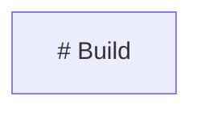
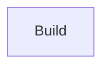

# Rules and safe fixes

Stage 3 adds a repository-private asynchronous Rule Engine inside Diagram Validation. Official Mermaid remains the only canonical syntax authority: rules may add Findings, but they cannot accept syntax that Mermaid rejects or replace the canonical parser verdict.

## Built-in rule

`flowchart/no-markdown-heading-in-label` is enabled as a warning by default. It examines Flowchart node-label Markdown Strings and reports an ATX heading marker at a line start after zero to three spaces. A definite marker has one to six unescaped `#` characters, horizontal whitespace, and non-empty content. The safe edit removes only the hashes and following horizontal whitespace.

For example:



becomes:



The scanner covers legacy node delimiters and modern `@{ shape: ..., label: ... }` declarations. It ignores plain quoted labels, edge labels, comments, escaped hashes, `#nospace`, seven hashes, more than three leading spaces, and ambiguous or unterminated label boundaries. It does not use an unofficial AST or renderer.

## Safety contract

Candidate edits use non-empty, zero-based, half-open UTF-16 spans in the host document. Stage 3 supports deletion and replacement but rejects zero-length insertion edits; insertion remains deferred until a concrete rule requires explicit Markdown boundary semantics. Markdown edits are exposed only when the entire replacement lies inside one copied source-map segment, so a fix cannot consume list or blockquote prefixes. Before producing writable output, Diagram Validation:

1. preserves and blocks on every original Mermaid or system error;
2. rejects invalid or zero-length bounds and overlapping replacements;
3. applies accepted edits in deterministic descending-offset order without normalizing text;
4. revalidates the proposed document with official Mermaid;
5. reruns the complete enabled rule selection and rejects output if any rule proposes another safe edit.

Each document is all-or-nothing at the replacement boundary. A blocked plan does not prevent another safe document from being applied. Stage 3 does not provide cross-file transactions or hidden backups.

## Preview and application

Use dry-run for inspection:

```sh
node dist/cli/main.js --fix-dry-run --format json diagram.mmd
```

Dry-run never writes. The top-level document and collection summary describe unchanged disk contents. A changed preview has `fix.status: "previewed"`, sorted host edits, full proposed `output`, and a nested `proposedResult` whose spans refer to that output.

Apply after review:

```sh
node dist/cli/main.js --fix diagram.mmd docs/
```

Apply mode plans every readable document before the first write, then processes paths deterministically. Each proposed file is prepared in an exclusive same-directory temporary file, synced, assigned the existing file mode, closed, and atomically renamed over the target. Preparation or rename failure cleans owned temporary state while leaving the target unchanged. A successful replacement has `fix.status: "applied"` and reports the post-fix Validation Result. A blocked plan remains `"blocked"`; an unchanged file is `"unchanged"`. A bounded replacement failure becomes `input/write-failed`, uses `"write-failed"`, retains the original result, and does not prevent later safe writes. Version control and an idempotent rerun are the recovery path if a subset was written.

Stage 3 preserves ordinary permission bits but does not promise preservation of ACLs, extended attributes, ownership, hard-link identity, or symlink-referent behavior. It also does not detect concurrent external edits or provide directory-sync crash durability.

## Registration status

The repository proves extensibility with an external-style fixture rule registered through the candidate seam without adding its id to a closed union. This is not a package API: configuration cannot load JavaScript modules, the package has no rule exports or declarations, and the seam may change through Stage 5. Stage 6 decides whether any plugin interface becomes public and supported.
